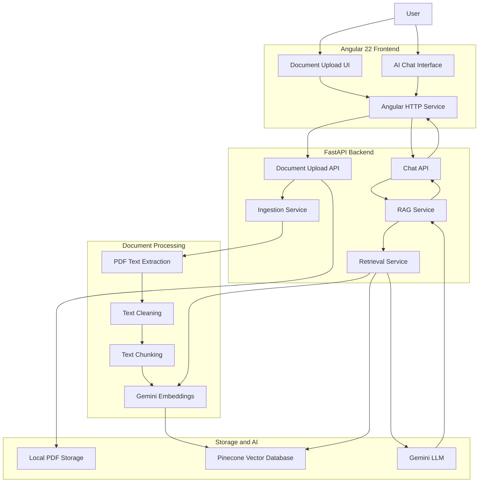
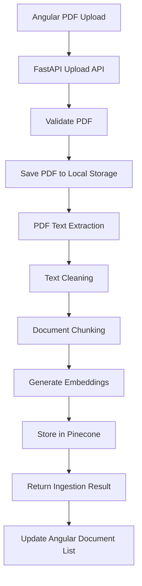
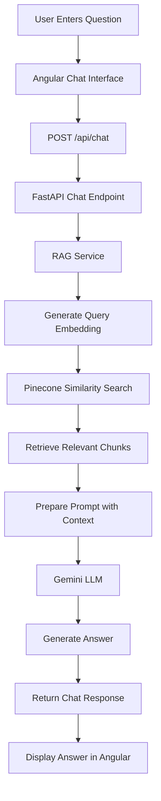

# KnowSphere AI – Enterprise RAG Assistant

**An AI-powered enterprise knowledge assistant built using Angular, FastAPI, LangChain, Google Gemini and Pinecone.**

KnowSphere AI is a document-based question-answering application that enables organizations to upload PDF documents and interact with their content using natural language.

The application uses Retrieval-Augmented Generation (RAG) to retrieve relevant information from uploaded documents and generate context-aware answers using a Large Language Model (LLM).

---

# 1. Project Overview

Organizations maintain large amounts of information across employee handbooks, HR policies, IT documentation, technical manuals and internal guidelines.

Finding specific information across these documents manually can be time-consuming.

KnowSphere AI addresses this problem by providing a centralized AI-powered knowledge assistant.

Users can upload organizational PDF documents, process their content, store document embeddings in a vector database and ask questions to retrieve relevant information.

### Key Objectives

- Build a centralized organizational knowledge base.
- Extract and process information from PDF documents.
- Convert document content into vector embeddings.
- Store embeddings in a vector database.
- Retrieve relevant information using semantic similarity search.
- Generate contextual answers using an LLM.
- Provide a conversational interface for interacting with organizational documents.

# 2. Key Features

### 2.1 Document Management

- Upload multiple PDF documents.
- Validate uploaded file types.
- Store uploaded documents on the backend.
- Display uploaded document information.
- Track document processing status.

### 2.2 Document Ingestion

- Extract text from PDF pages.
- Clean extracted document content.
- Split documents into smaller chunks.
- Generate embeddings using Google Gemini.
- Store document chunks and embeddings in Pinecone.
- Organize vector data using organization-specific namespaces.

### 2.3 AI-Powered Question Answering

- Accept natural-language questions.
- Convert questions into vector embeddings.
- Retrieve relevant document chunks using semantic similarity search.
- Provide retrieved context to the Gemini LLM.
- Generate context-aware answers.
- Display AI-generated responses in the Angular chat interface.

### 2.4 Organization-Based Data Separation

- Use organization-specific Pinecone namespaces.
- Separate document ingestion and retrieval using organization identifiers.
- Provide a foundation for multi-organization knowledge management.

---
## 3. Technology Stack

| Layer                 | Technology                  | Purpose 
|-----------------------|-----------------------------|----------------------
| Frontend              | Angular 22                  | User interface 
| Programming Language  | TypeScript                  | Frontend development 
| UI Styling            | SCSS                        | Application styling 
| Backend               | FastAPI                     | REST API development 
| Programming Language  | Python                      | Backend development 
| PDF Processing        | PyPDF                       | PDF text extraction 
| AI Framework          | LangChain                   | RAG pipeline orchestration 
| Embedding Model       | Google Gemini Embeddings    | Text-to-vector conversion 
| Vector Database       | Pinecone                    | Vector storage and retrieval 
| Large Language Model  | Google Gemini               | Answer generation 
| API Communication     | HTTP / REST                 | Frontend-backend communication 

---

# 4. System Architecture

KnowSphere AI follows a Retrieval-Augmented Generation architecture.

The application consists of two primary workflows:

1. Document Ingestion Pipeline
2. Question Answering and Retrieval Pipeline

## 4.1 High-Level Architecture



## 4.2 Architecture Responsibilities

| Component          | Responsibility 
|--------------------|------------------------------------------------
| Angular            | User interaction and document/chat interface 
| FastAPI            | Exposes backend APIs 
| PDF Loader         | Extracts content from PDF documents 
| Text Cleaner       | Cleans extracted text 
| Text Splitter      | Divides documents into smaller chunks 
| Embedding Service  | Initializes and provides the embedding model 
| Pinecone Service   | Initializes Pinecone and vector-store connections 
| Retrieval Service  | Retrieves relevant document chunks 
| LLM Service        | Initializes the Gemini chat model 
| RAG Service        | Coordinates retrieval and answer generation 

---

# 5. Project Dependencies and Libraries

This section explains the packages used in the project and why each dependency is required.

## 5.1 Python Backend Dependencies

### A. Core Backend Packages

| Package               | Purpose                                                                     | Where It Is Used 
|-------------------    |---------------------------------------------------------------------------- |
| `fastapi`             | Python framework for building REST APIs. Provides routing, request validation and response handling.                                                                                             | Document upload and chat endpoints. 
| `uvicorn[standard]`   | ASGI server used to run FastAPI applications.                               | Starts the backend application.
| `python-multipart`    | Enables FastAPI to receive files using multipart form data.                 | Receiving PDF files through `UploadFile` and `File()`. 
| `pydantic-settings`   | Provides typed application configuration and environment variable management| Loading application settings and API configuration. 
| `python-dotenv` | Loads environment variables from a `.env` file when using `load_dotenv()`.         | Accessing API keys without hardcoding them. 

### B. PDF Processing

| Package | Purpose                                                                         | Where It Is Used 
|---      |---------------------------------------------------------------------------------|-----------------------------------
| `pypdf` | Python library for reading PDF files and extracting text from individual pages. | PDF loading and text extraction. 

Example:

```python
from pypdf import PdfReader

reader = PdfReader("employee_handbook.pdf")

for page in reader.pages:
    text = page.extract_text()
```

Why do we need it?

PDF files contain content in a document format. Before creating embeddings, we need to extract the actual textual information.

PyPDF helps us read PDF pages and extract their text.

### C. LangChain Packages

Instead of installing the entire LangChain framework, this project uses individual packages for the required functionality.

| Package | Purpose | Where It Is Used |
|---|---|---|
| `langchain-core` | Provides fundamental LangChain abstractions and interfaces. | Document objects, prompts and runnable components. |
| `langchain-text-splitters` | Provides text-splitting algorithms. | Splitting extracted PDF content into chunks. |
| `langchain-pinecone` | Integrates LangChain with Pinecone. | Vector storage and similarity search. |
| `langchain-google-genai` | Integrates Google Gemini models with LangChain. | Gemini embeddings and Gemini chat model. |

#### 1. langchain-core

This package provides the fundamental building blocks of LangChain.

Important components include:

- `Document`: Represents text content along with metadata.
- `PromptTemplate`: Creates structured prompts.
- `Runnable`: Provides interfaces for composing processing steps.
- Core embedding and model interfaces.

Example:

```python
from langchain_core.documents import Document

document = Document(
    page_content="Employees receive 18 days of annual leave.",
    metadata={
        "source": "employee_handbook.pdf",
        "page": 1
    }
)
```

Why do we need it?

It provides a standardized way to represent documents and connect different components of the RAG pipeline.

#### 2. langchain-text-splitters

Provides algorithms to split large text into smaller, manageable chunks.

Example:

```python
from langchain_text_splitters import RecursiveCharacterTextSplitter

text_splitter = RecursiveCharacterTextSplitter(
    chunk_size=700,
    chunk_overlap=100
)

chunks = text_splitter.split_documents(documents)
```

Why do we need it?

Sending an entire PDF to an LLM for every question is inefficient.

Chunking allows the application to retrieve only the relevant sections instead of processing the complete document.

#### 3. langchain-pinecone

Provides integration between LangChain and Pinecone.

Important component:

```python
from langchain_pinecone import PineconeVectorStore
```

Important methods:

```python
vector_store.add_documents(chunks)

retrieved_docs = vector_store.similarity_search(
    query,
    k=5
)
```

Why do we need it?

It allows LangChain to communicate with Pinecone using a standardized vector-store interface.

It also handles embedding generation through the configured embedding model when documents are added or queries are searched.

#### 4. langchain-google-genai

Provides integration between LangChain and Google's Gemini models.

Important classes:

```python
from langchain_google_genai import (
    GoogleGenerativeAIEmbeddings,
    ChatGoogleGenerativeAI
)
```

**GoogleGenerativeAIEmbeddings**

Converts text into numerical vectors.

Used during:

- Document ingestion.
- User-question embedding generation.

**ChatGoogleGenerativeAI**

Provides access to Gemini chat models.

Used during:

- Answer generation.
- Processing retrieved context and user questions.

Why do we need it?

It allows us to use Gemini models through LangChain interfaces instead of implementing separate integration logic for every operation.

### D. Pinecone Package

| Package | Purpose | Where It Is Used |
|---|---|---|
| `pinecone` | Official Pinecone Python SDK. Provides access to Pinecone indexes and vector database operations. | Connecting to Pinecone, accessing indexes and managing the underlying vector database. |

Important distinction:

- `pinecone` is the official database SDK.
- `langchain-pinecone` integrates Pinecone with LangChain.

In our implementation, `PineconeVectorStore` handles document insertion and retrieval. We do not manually generate embeddings and upsert them separately.

## 5.2 Complete Python Dependency Reference

The following is the direct dependency reference for the described Gemini-based implementation.

```txt
fastapi
uvicorn[standard]
python-multipart

pydantic-settings
python-dotenv

pypdf

langchain-core
langchain-text-splitters
langchain-pinecone
langchain-google-genai

pinecone
```

Use the exact installed and tested package versions in the final `requirements.txt`.

## 5.3 Packages Explored During Development

The following packages were also discussed during development but are not necessarily required by the current Gemini-based implementation.

| Package | Purpose | Current Usage |
|---|---|---|
| `langchain` | Higher-level LangChain framework and convenience abstractions. | Not required solely for the individual integrations listed above. |
| `langchain-community` | Community-maintained integrations. | Not required by the described current pipeline. |
| `langchain-openai` | OpenAI model and embedding integration. | Not needed for the current Gemini implementation. |
| `openai` | Official OpenAI Python SDK. | Not needed unless OpenAI APIs are added. |
| `tiktoken` | Tokenizer commonly used for OpenAI token counting. | Not required by the current pipeline. |
| `aiofiles` | Provides asynchronous file operations. | Not required by the current `Path.write_bytes()` storage approach. |

---

# 6. Angular Frontend Dependencies

The frontend is developed using Angular 22.

| Package | Purpose | Where It Is Used |
|---|---|---|
| `@angular/core` | Core Angular functionality, components and dependency injection. | Components and services. |
| `@angular/common` | Common Angular directives and utilities. | `CommonModule`, template functionality and common directives. |
| `@angular/forms` | Provides Angular form functionality. | `FormsModule` and `[(ngModel)]`. |
| `@angular/router` | Client-side navigation. | Application routing, when used. |
| `rxjs` | Reactive programming library based on Observables. | HTTP requests, subscriptions and operators such as `finalize()`. |
| `typescript` | Adds static typing to JavaScript. | Component logic, interfaces and services. |
| `sass` | CSS preprocessor. | SCSS component styling. |

### Important Angular Concepts Used

**Components**

Used to divide the application into reusable UI sections.

**Services**

Used to centralize API communication and business logic.

**Dependency Injection**

Allows Angular to provide services to components.

**HttpClient**

Used to communicate with FastAPI endpoints.

**RxJS Observables**

Used to handle asynchronous HTTP responses.

**Angular Control Flow**

The application uses `@if` and `@for` to conditionally render pages and iterate over documents and chat messages.

## 6.1 Frontend API Communication

The Angular `CommonService` is responsible for communicating with FastAPI.

Example:

```typescript
uploadDocuments(files: File[]): Observable<any> {
  const formData = new FormData();

  files.forEach(file => {
    formData.append('files', file);
  });

  return this.http.post(
    `${this.baseUrl}/api/documents/upload`,
    formData
  );
}
```

For chat:

```typescript
sendMessage(payload: {
  question: string;
  organization_id: string;
}): Observable<any> {
  return this.http.post(
    `${this.baseUrl}/api/chat`,
    payload
  );
}
```

---

# 7. Document Ingestion Pipeline

The ingestion pipeline processes uploaded PDF documents and stores their vector representations in Pinecone.

## 7.1 Ingestion Workflow



## 7.2 Step-by-Step Explanation

### Step 1: PDF Upload

The user selects one or more PDF documents from the Angular interface.

Angular sends the actual PDF `File` objects to FastAPI using `FormData`.

API:

`POST /api/documents/upload`

Content type:

`multipart/form-data`

### Step 2: PDF Validation and Storage

FastAPI receives uploaded files using:

```python
files: Annotated[list[UploadFile], File()]
```

The backend validates the filenames and extensions, reads the file content and saves the PDFs to local storage.

A unique filename is generated to avoid filename collisions.

### Step 3: PDF Text Extraction

PyPDF extracts text from individual PDF pages.

The extracted content is represented as LangChain `Document` objects.

Each document contains:

- `page_content`: Extracted page text.
- `metadata`: Source filename and page information.

### Step 4: Text Cleaning

Extracted text is passed through the custom text-cleaning function.

The cleaning process prepares the text for chunking by removing unnecessary whitespace and unwanted formatting.

### Step 5: Document Chunking

The cleaned documents are divided into smaller chunks using `RecursiveCharacterTextSplitter`.

Chunking helps the retrieval system find specific information without searching through the entire document content.

### Step 6: Embedding Generation

The Gemini embedding model converts the document chunks into numerical vector representations.

In this project, the embedding model is initialized separately in the embedding service.

The actual document embeddings are generated internally when:

```python
vector_store.add_documents(chunks)
```

The embedding model is passed to `PineconeVectorStore`.

### Step 7: Vector Storage

LangChain's `PineconeVectorStore` stores the document chunks and their embeddings in Pinecone.

The vector data is stored inside an organization-specific namespace.

This allows retrieval to search within the intended organization's document collection.

---

# 8. Question Answering and Retrieval Pipeline

The retrieval pipeline processes user questions and generates answers using information from previously uploaded documents.

## 8.1 Retrieval Workflow



## 8.2 Step-by-Step Explanation

### Step 1: User Question

The user enters a natural-language question in the Angular chat interface.

Example:

"What is the company's leave policy?"

### Step 2: Chat API

Angular sends the question and organization identifier to FastAPI.

API:

`POST /api/chat`

Request:

```json
{
  "question": "What is the company's leave policy?",
  "organization_id": "org_001"
}
```

### Step 3: Query Embedding

The question is converted into a numerical vector using the configured Gemini embedding model.

The same embedding model used during document ingestion must be used during retrieval.

### Step 4: Similarity Search

Pinecone performs semantic similarity search to find document chunks relevant to the user's question.

Example:

```python
retrieved_docs = vector_store.similarity_search(
    query,
    k=5
)
```

Here, `k=5` requests the five most relevant document chunks.

### Step 5: Context Preparation

The retrieved document chunks are combined with the user's question to construct the LLM prompt.

The LLM receives relevant context instead of the complete PDF collection.

### Step 6: Answer Generation

The Gemini LLM receives the question and retrieved context.

It generates a natural-language answer based on the supplied information.

### Step 7: Response to Angular

FastAPI returns the generated answer.

Example:

```json
{
  "answer": "Employees receive 18 days of annual paid leave and 8 days of paid sick leave per calendar year."
}
```

Angular displays the response in the chat interface.

---

# 9. Project Folder Structure

The following is the logical project structure based on the architecture.

Individual filenames can be adjusted to match the actual implementation.

```text
enterprise-rag-assistant/
│
├── app/
│   │
│   ├── main.py
│   │
│   ├── api/
│   │   ├── document_routes.py
│   │   └── chat_routes.py
│   │
│   ├── schemas/
│   │   ├── document_schema.py
│   │   └── chat_schema.py
│   │
│   ├── ingestion/
│   │   ├── pdf_loader.py
│   │   ├── text_cleaner.py
│   │   ├── document_splitter.py
│   │   └── ingestion_service.py
│   │
│   ├── embeddings/
│   │   └── embedding_service.py
│   │
│   ├── vectorstore/
│   │   └── pinecone_service.py
│   │
│   ├── retrieval/
│   │   └── retrieval_service.py
│   │
│   ├── llm/
│   │   └── llm_service.py
│   │
│   └── rag/
│       └── rag_service.py
│
├── data/
│   └── documents/
│
├── frontend/
│   ├── src/
│   │   └── app/
│   │       ├── Services/
│   │       │   └── common.ts
│   │       ├── app.ts
│   │       ├── app.html
│   │       └── app.scss
│   │
│   └── package.json
│
├── .env
├── .env.example
├── .gitignore
├── requirements.txt
└── README.md
```

## 9.1 Backend Module Responsibilities

| Module | Responsibility |
|---|---|
| `main.py` | FastAPI application initialization and route registration |
| `api/` | API endpoint definitions |
| `schemas/` | Pydantic request and response schemas |
| `ingestion/` | PDF loading, cleaning, splitting and ingestion orchestration |
| `embeddings/` | Embedding model initialization and dimension validation |
| `vectorstore/` | Pinecone connection and vector-store initialization |
| `retrieval/` | Similarity search and document retrieval |
| `llm/` | Gemini LLM initialization |
| `rag/` | Coordinates retrieval and answer generation |

---

# 10. API Documentation

The application currently exposes two primary API endpoints.

## 10.1 Upload Documents

**Endpoint**

`POST /api/documents/upload`

**Content-Type**

`multipart/form-data`

**Request**

The API accepts one or more PDF files under the `files` field.

**Backend Responsibilities**

- Validate uploaded PDFs.
- Save documents to local storage.
- Execute the ingestion pipeline.
- Generate embeddings.
- Store vectors in Pinecone.
- Return ingestion metadata.

**Response Structure**

The exact fields depend on the dictionary returned by the ingestion service.

Example:

```json
{
  "message": "Documents uploaded and processed successfully",
  "total_files": 1,
  "uploaded_files": [
    {
      "filename": "employee_handbook.pdf",
      "stored_filename": "unique_employee_handbook.pdf"
    }
  ]
}
```

## 10.2 Ask a Question

**Endpoint**

`POST /api/chat`

**Content-Type**

`application/json`

**Request**

```json
{
  "question": "What is the company's leave policy?",
  "organization_id": "org_001"
}
```

**Backend Responsibilities**

- Validate the incoming question.
- Identify the organization namespace.
- Execute the RAG pipeline.
- Retrieve relevant document chunks.
- Generate an answer using Gemini.
- Return the generated response.

**Response**

```json
{
  "answer": "Based on the uploaded documents, employees receive annual paid leave and paid sick leave."
}
```

---

# 11. Environment Configuration

Create a `.env` file in the backend project root.

Example:

```env
GOOGLE_API_KEY=your_gemini_api_key

PINECONE_API_KEY=your_pinecone_api_key

PINECONE_INDEX_NAME=your_pinecone_index_name
```

Use the exact environment variable names expected by the application's configuration code.

### Why use environment variables?

- Avoid hardcoding API keys.
- Keep secrets separate from application code.
- Make configuration easier across development and production environments.
- Reduce the risk of accidentally exposing credentials.

Create a `.env.example` file containing placeholder values.

Never commit your actual `.env` file to GitHub.

---

# 12. Installation and Setup

## 12.1 Prerequisites

- Python
- Node.js and npm
- Angular CLI
- Google Gemini API key
- Pinecone API key
- Pinecone index

## 12.2 Backend Setup

Navigate to the backend project directory:

```bash
cd enterprise-rag-assistant
```

Create a virtual environment:

```bash
python -m venv venv
```

Activate it on Windows:

```bash
venv\Scripts\activate
```

Install the Python dependencies:

```bash
pip install -r requirements.txt
```

Configure the `.env` file.

Start the FastAPI server:

```bash
uvicorn app.main:app --reload
```

Backend URL:

`http://localhost:8000`

Swagger API documentation:

`http://localhost:8000/docs`

## 12.3 Frontend Setup

Navigate to the Angular frontend directory:

```bash
cd frontend
```

Install dependencies:

```bash
npm install
```

Start the Angular application:

```bash
ng serve
```

Frontend URL:

`http://localhost:4200`

---

# 13. Important RAG Concepts Used in This Project

| Concept | Explanation |
|---|---|
| Document Loader | Extracts content from PDF files. |
| Document | Represents text content along with metadata. |
| Text Cleaning | Prepares extracted text for further processing. |
| Text Splitter | Divides large documents into smaller chunks. |
| Embeddings | Converts text into numerical vector representations. |
| Vector Database | Stores and retrieves embeddings. |
| Similarity Search | Finds semantically similar vectors. |
| Retriever | Retrieves relevant document chunks. |
| Prompt Template | Structures the question and retrieved context. |
| LLM | Generates natural-language answers. |
| RAG | Combines retrieval with generation to provide context-aware responses. |

## 13.1 Why Do We Need RAG?

A general-purpose LLM may not know the latest or private information contained in an organization's internal documents.

RAG addresses this limitation by retrieving relevant information from an external knowledge source and providing that information as context to the LLM.

Instead of relying only on its pretrained knowledge, the LLM can generate answers based on the retrieved organizational information.

---

# 14. Current Implementation Status

The following features have been implemented or integrated in the development workflow:

### Frontend

- [x] Angular 22 application setup
- [x] Document upload interface
- [x] Multiple PDF selection
- [x] Document list UI
- [x] Chat interface
- [x] FastAPI integration through Angular service
- [x] Display AI-generated responses

### Backend

- [x] FastAPI application setup
- [x] CORS configuration
- [x] PDF upload endpoint
- [x] PDF file storage
- [x] PDF text extraction
- [x] Text cleaning
- [x] Document chunking
- [x] Gemini embedding integration
- [x] Pinecone vector-store integration
- [x] Organization-specific namespace configuration
- [x] Chat API
- [x] Similarity search
- [x] Gemini LLM integration
- [x] RAG answer generation

---

# 15. Future Enhancements

The following improvements can be added to make KnowSphere AI more production-ready.

### Document Management

- [ ] Persistent document metadata storage using a relational database.
- [ ] Document listing API.
- [ ] Document deletion and vector cleanup.
- [ ] Duplicate document detection.
- [ ] Document processing status tracking.

### RAG Improvements

- [ ] Source citations with document names and page numbers.
- [ ] Streaming AI responses.
- [ ] Metadata-based retrieval filters.
- [ ] Retrieval reranking.
- [ ] Conversation history.
- [ ] Better handling of unanswerable questions.
- [ ] Retrieval quality evaluation.

### Security

- [ ] User authentication and authorization.
- [ ] Secure organization-level access control.
- [ ] Organization ID derived from authenticated users.
- [ ] File size restrictions and content validation.
- [ ] Secure document storage.

### Performance

- [ ] Reuse model and vector-store clients.
- [ ] Optimize retrieval parameters.
- [ ] Background document ingestion.
- [ ] Response-time monitoring.
- [ ] Caching where appropriate.

### Testing

- [ ] Unit tests for PDF extraction.
- [ ] Unit tests for text cleaning and chunking.
- [ ] Integration tests for Pinecone retrieval.
- [ ] API tests for upload and chat endpoints.
- [ ] RAG answer quality evaluation.

---

# 16. Security Considerations

- Store API keys in environment variables.
- Never expose API credentials in frontend code.
- Validate uploaded files on the backend.
- Enforce file size limits.
- Avoid exposing internal server file paths.
- Derive organization identity from authenticated users in production.
- Apply organization-level access controls to retrieval.
- Protect stored documents and vector data.
- Avoid returning confidential document information to unauthorized users.

---

# 17. Conclusion

KnowSphere AI demonstrates how Retrieval-Augmented Generation can be used to build an enterprise document knowledge assistant.

By combining Angular, FastAPI, LangChain, Google Gemini and Pinecone, the application provides a foundation for uploading organizational documents, retrieving relevant information and generating context-aware answers through natural-language conversations.

The application separates document ingestion, embedding generation, vector storage, retrieval and answer generation into logical modules, making the system easier to understand, maintain and extend.

**KnowSphere AI – Transforming organizational documents into an intelligent knowledge assistant.**
